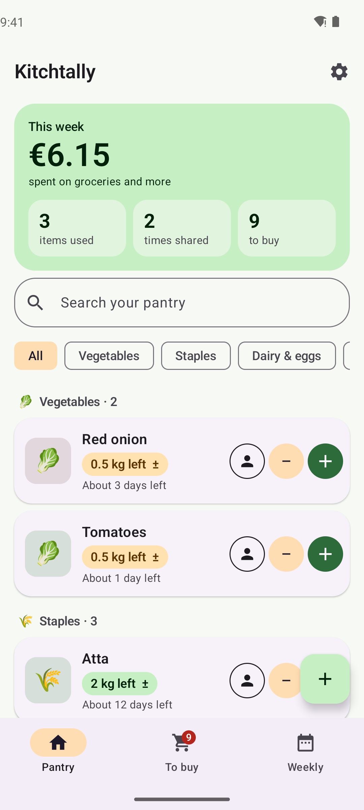
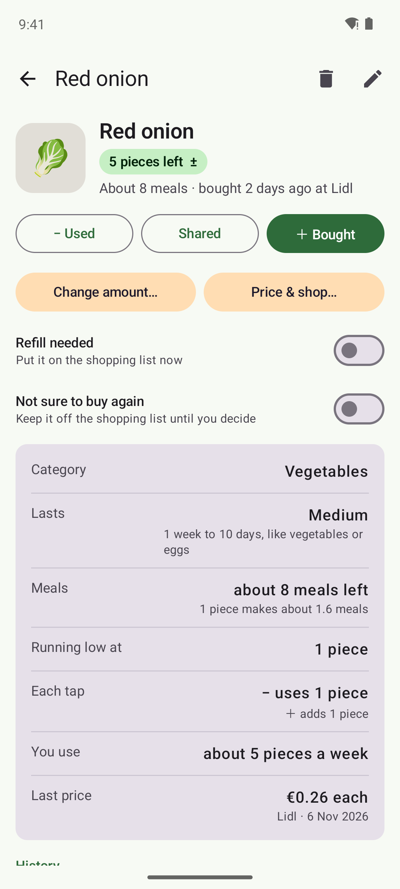
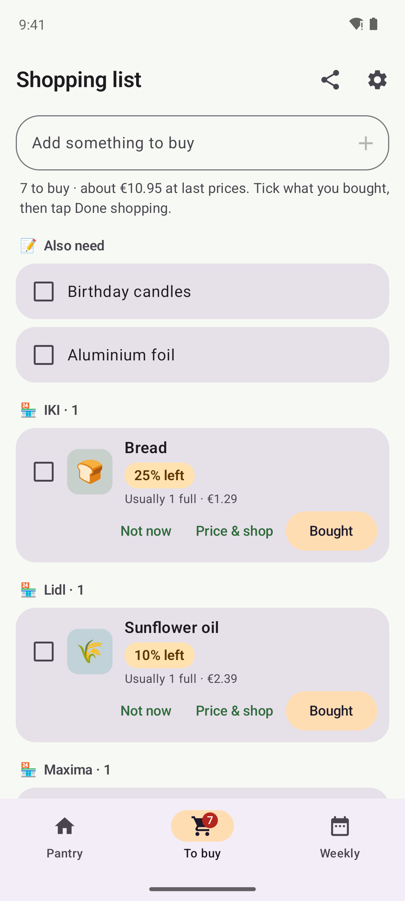
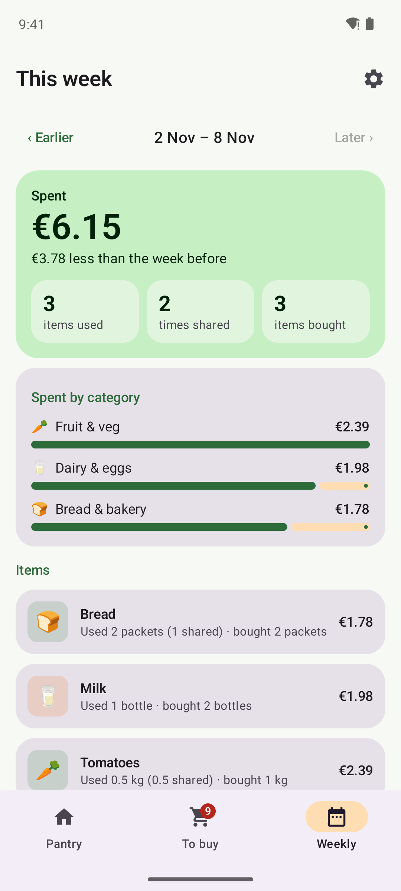

# Kitchtally

**An offline pantry tracker for Android and iPhone. Know what's at home, what's running out, and what you spend each week.**

Rice, atta, bread, onions, shampoo: add the things you keep at home, tap **＋** when you buy more, **−** when you use some, and **Shared** when you cook for friends. Kitchtally counts what's left, warns you before it runs out, builds your shopping list and shows a weekly summary. Your data never leaves your phone: no internet, no account, no ads and no tracking.

<p>
  
  
  
  
</p>

## Install

Download from **[Releases](../../releases/latest)**. Kitchtally isn't in an app store yet, so your phone asks you to confirm the first time.

| Device | File | Requires |
|---|---|---|
| Android | `Kitchtally-x.y.z-Android.apk` | Android 8.0+ |
| iPhone, iPad | `Kitchtally-x.y.z-iOS.ipa` | iOS 16+, installed with a sideloading tool |

<details>
<summary><b>Android</b></summary>

1. Download the APK on your phone and open it. If Android asks, allow your browser or Files app to **install unknown apps**.
2. If Play Protect warns about an unknown developer, tap **More details → Install anyway**.
3. **Samsung Galaxy (One UI 6+):** if the install is blocked, turn off **Settings → Security and privacy → Auto Blocker**, install, then turn it back on.

Updates install over the old version and keep your data.
</details>

<details>
<summary><b>iPhone and iPad</b></summary>

1. On a Windows PC or Mac, install **[Sideloadly](https://sideloadly.io)** or **[AltStore](https://altstore.io)**.
2. Connect your iPhone, drag in `Kitchtally-x.y.z-iOS.ipa`, and sign in with your Apple ID.
3. On the iPhone, open **Settings → General → VPN & Device Management**, tap your Apple ID and choose **Trust**. Also turn on **Settings → Privacy & Security → Developer Mode**.

With a free Apple ID the app must be refreshed every 7 days (AltStore does this automatically). Your data stays on the phone.
</details>

## Features

**Pantry**
- Items with a photo (camera or gallery), category, unit (pieces, packets, bottles, boxes, bags, kg, litres) and how long they last: short (bread, milk), medium (onions, eggs) or long (rice, atta, pasta)
- **＋** adds one more (for kilos and litres, the bag size you usually buy), logged as refilled today at last time's shop and price
- **−** uses the item's amount per tap, for example 1 packet of bread or 0.5 kg of rice. **Shared** does the same for cooking with friends; it counts quantity only, never money
- **Packs:** count eggs in pieces with "packs of 10"; ＋ adds a whole pack, − takes one egg
- **Any amount:** tap the amount to use, share or buy −2, +2 or any number, or set what's left after counting
- Stock never goes below zero, and search finds any item
- Every quick action can be undone
- Stock pills: green when there's enough, amber when running low, red when out
- "About 4 days left", worked out from how fast you've been using it
- "Check it's fresh" for short-life items bought a while ago

**Purchases**
- Quantity, date, total paid **or** price per kg / per packet (it works out the other), shop and an optional receipt photo
- Shops: IKI, Norfa, Maxima, Lidl, Rimi, Pepco, or type your own; it's remembered for next time
- Last price and shop shown on each item

**Shopping list** (its own tab)
- Type anything at the top, like candles or foil, and tick it off in the shop. Typing a pantry item's name marks that item instead
- Pantry items that are out, running low (at or below your "running low at" amount, or likely to run out within 2 days), or marked **Refill needed**
- **Bought** logs your usual amount at your usual price, **Price & shop** to enter details, **Not now** hides an item until you next buy it
- **Not sure to buy again:** one tap keeps an item off the shopping list for good, in its own pantry group, until you change your mind
- An estimate of the total at last prices

**Weekly summary** (Monday to Sunday)
- Money spent, compared with the week before, and spent by category
- Items used, times shared and items bought
- Used and shared per item: "Bread: used 3 packets (1 shared), bought 2"
- Go back to any earlier week

**Categories:** 🥬 Vegetables, 🍎 Fruit, 🌾 Staples, 🥫 Sauces & spreads, 🥛 Dairy & eggs, 🍗 Meat & protein, 🍞 Bread & bakery, 🌶️ Spices, 🍪 Snacks, 🥤 Drinks, 🧴 Personal care, 🧻 Household, 📦 Other, or your own. Type a name and Kitchtally picks the category, unit and how long it lasts: "Eggs" becomes Dairy & eggs, pieces, packs of 10.

**Backup:** export to a file and import it on a new phone, Android or iPhone. Photos stay on the phone.

## Privacy

| | |
|---|---|
| Internet | None. The Android build fails if the app ever asks for internet access |
| Storage | Only on your phone, in the app's private storage |
| Cloud backup | Disabled on Android |
| Photos | Resized and kept in the app's private storage |

See [PRIVACY.md](PRIVACY.md).

## How it's built

| Platform | Built with |
|---|---|
| Android | Kotlin, Jetpack Compose, Material 3, Room |
| iPhone, iPad | Swift and SwiftUI, a port of the same logic with the same unit tests |

Unit tests cover stock counting, tap amounts, running-low and days-left estimates, prices per kg, weekly summaries and backups. They run for Android and on an iPhone simulator for every change, and an Android emulator checks that data from older versions upgrades correctly. Raising the number in `version.txt` builds both apps on GitHub Actions and publishes them together. The screenshots are taken by a robot that opens the app with sample data in an Android emulator.

```
app/   Android app
ios/   iPhone and iPad app (XcodeGen project)
```

```bash
./gradlew :app:assembleDebug                                    # Android (JDK 17, Android SDK)
cd ios && xcodegen generate && open Kitchtally.xcodeproj        # iOS (macOS, Xcode 15+)
```

## Licence

MIT © 2026 Rachit Ratnam Mudaliar
