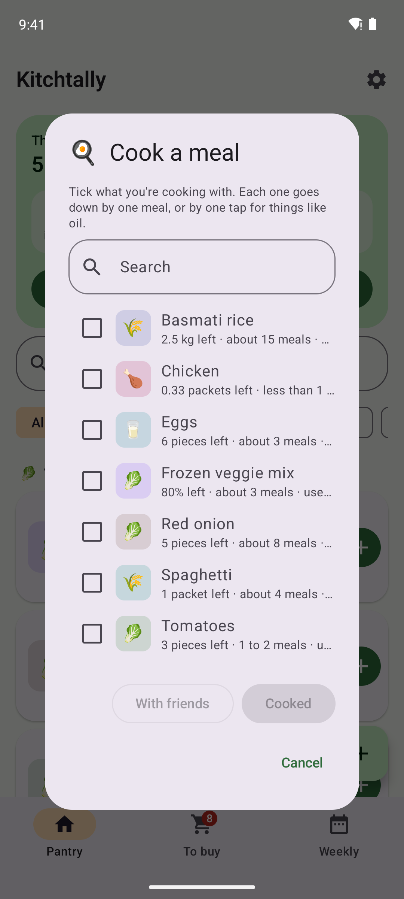
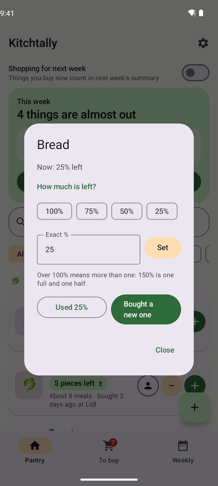
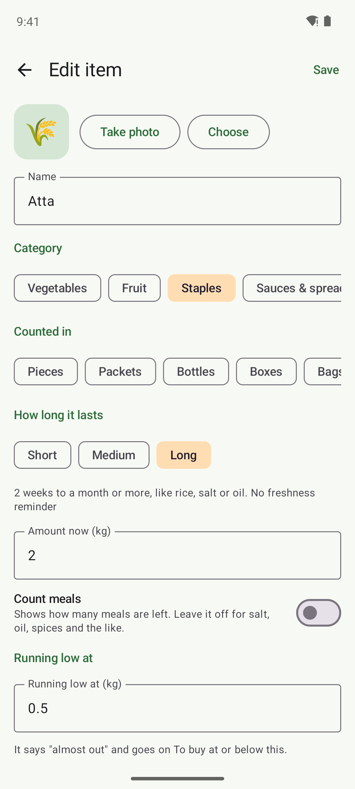
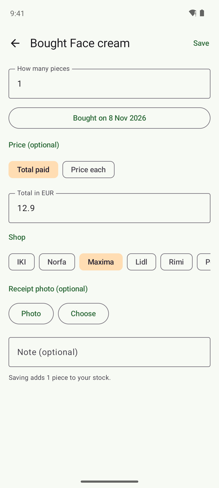

# Kitchtally

**An offline pantry tracker for Android and iPhone. Know what's at home, what's almost out, and how many meals you can still cook.**

Rice, atta, bread, onions, shampoo: add the things you keep at home, tap **＋** when you buy more, **−** when you use some, and **Shared** when you cook for friends. Kitchtally counts what's left, warns you before it runs out, builds your shopping list and shows a weekly summary. Your data never leaves your phone: no internet, no account, no ads and no tracking.

<p>
  
  
  
  
</p>
<p>
  
  
  
  
</p>

## Install

Download from **[Releases](../../releases/latest)**. Kitchtally isn't in an app store yet, so your phone asks you to confirm the first time.

| Device | File | Requires |
|---|---|---|
| Android | `Kitchtally-x.y.z-Android.apk` | Android 8.0+ |
| iPhone, iPad | `Kitchtally-x.y.z-iOS.ipa` | iOS 16+, installed with a sideloading tool |

<details>
<summary><b>Android</b></summary>

1. Download the APK on your phone and open it. If Android asks, allow your browser or Files app to **install unknown apps**.
2. If Play Protect warns about an unknown developer, tap **More details → Install anyway**.
3. **Samsung Galaxy (One UI 6+):** if the install is blocked, turn off **Settings → Security and privacy → Auto Blocker**, install, then turn it back on.

Updates install over the old version and keep your data.
</details>

<details>
<summary><b>iPhone and iPad</b></summary>

1. On a Windows PC or Mac, install **[Sideloadly](https://sideloadly.io)** or **[AltStore](https://altstore.io)**.
2. Connect your iPhone, drag in `Kitchtally-x.y.z-iOS.ipa`, and sign in with your Apple ID.
3. On the iPhone, open **Settings → General → VPN & Device Management**, tap your Apple ID and choose **Trust**. Also turn on **Settings → Privacy & Security → Developer Mode**.

With a free Apple ID the app must be refreshed every 7 days (AltStore does this automatically). Your data stays on the phone.
</details>

## Features

**Pantry**
- Items with a photo (camera or gallery), category, and how they're counted: pieces, packets, bottles, boxes, bags, **% left**, grams, kg, ml or litres
- **% left** for bread, oil, ketchup and opened packets: "80% left", "Full". Each − takes off 25% (or your own amount, like 5% for oil), and tapping the amount lets you pick 100 / 75 / 50 / 25% / Empty
- **Meals:** switch on "Count meals" and say how many meals something makes (1 pack of spaghetti = 4 meals, 5 onions = 8). Items then show "4 pieces left · about 6 meals", and turn red when one meal is left. Off for salt, oil and spices
- **🍳 Cook a meal:** tick what you're cooking with and tap Cooked. One meal comes off each item, or one tap for things like oil, in one go
- **"Almost out"** under any item at its low point (25% for % items, or the number of meals you choose). No notifications, just the line
- **＋** adds one more (a full one for % items, a whole pack for eggs, the bag size you usually buy for kilos and grams). **−** uses the item's amount per tap. **Shared** counts cooking with friends, quantity only
- **Any amount:** tap the amount to use, share or buy any number, or set what's left after counting
- Grams and millilitres are priced per kg and per litre
- Every quick action can be undone, and stock never goes below zero
- "Check it's fresh" after 3 days for short-life items (bread, milk) and 10 days for medium (vegetables, eggs). Long-life items like salt never nag

**Purchases**
- Quantity, date, total paid **or** price per kg / per packet (it works out the other), shop and an optional receipt photo
- **Price check:** "💡 Cheaper at Lidl last time: €1.59 each"
- "These make about … meals" for items that count meals
- Shops: IKI, Norfa, Maxima, Lidl, Rimi, Pepco, or type your own

**Shopping list** (its own tab)
- **Grouped by shop**, so you finish IKI before going to Lidl
- **Tick as you shop, then Done shopping** logs everything you bought in one tap
- **Share** the list as text to WhatsApp or anywhere
- Type anything at the top, like candles or foil. Typing a pantry item's name marks that item instead
- **Not now** hides an item until you next buy it; **Not sure to buy again** keeps it off the list for good
- An estimate of the total at last prices

**Weekly** (Monday to Sunday)
- Opens with what's **new this week**: what you bought and what you used
- **Money stays out of sight** until you tap Show spending. Then: spent this week, compared with the week before, by category, and an optional monthly budget
- Go back to any earlier week

**Home screen widget** (Android): how many things are on your To buy list and what's almost out. Tap it to open the list.

**Categories:** 🥬 Vegetables, 🍎 Fruit, 🌾 Staples, 🥫 Sauces & spreads, 🥛 Dairy & eggs, 🍗 Meat & protein, 🍞 Bread & bakery, 🌶️ Spices, 🍪 Snacks, 🥤 Drinks, 🧴 Personal care, 🧻 Household, 📦 Other, or your own. Type a name and Kitchtally picks the category, how it's counted, how long it lasts and whether to count meals: "Oil" becomes Staples, % left; "Potato" becomes Vegetables, pieces, counting meals.

**Backup:** export to a file and import it on a new phone, Android or iPhone. Photos stay on the phone.

## Privacy

| | |
|---|---|
| Internet | None. The Android build fails if the app ever asks for internet access |
| Storage | Only on your phone, in the app's private storage |
| Cloud backup | Disabled on Android |
| Photos | Resized and kept in the app's private storage |

See [PRIVACY.md](PRIVACY.md).

## How it's built

| Platform | Built with |
|---|---|
| Android | Kotlin, Jetpack Compose, Material 3, Room |
| iPhone, iPad | Swift and SwiftUI, a port of the same logic with the same unit tests |

Unit tests cover stock counting, tap amounts, running-low and days-left estimates, prices per kg, weekly summaries and backups. They run for Android and on an iPhone simulator for every change, and an Android emulator checks that data from older versions upgrades correctly. Raising the number in `version.txt` builds both apps on GitHub Actions and publishes them together. The screenshots are taken by a robot that opens the app with sample data in an Android emulator.

```
app/   Android app
ios/   iPhone and iPad app (XcodeGen project)
```

```bash
./gradlew :app:assembleDebug                                    # Android (JDK 17, Android SDK)
cd ios && xcodegen generate && open Kitchtally.xcodeproj        # iOS (macOS, Xcode 15+)
```

## Licence

MIT © 2026 Rachit Ratnam Mudaliar
